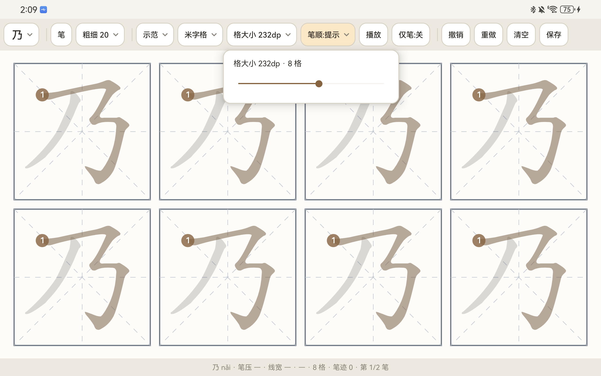
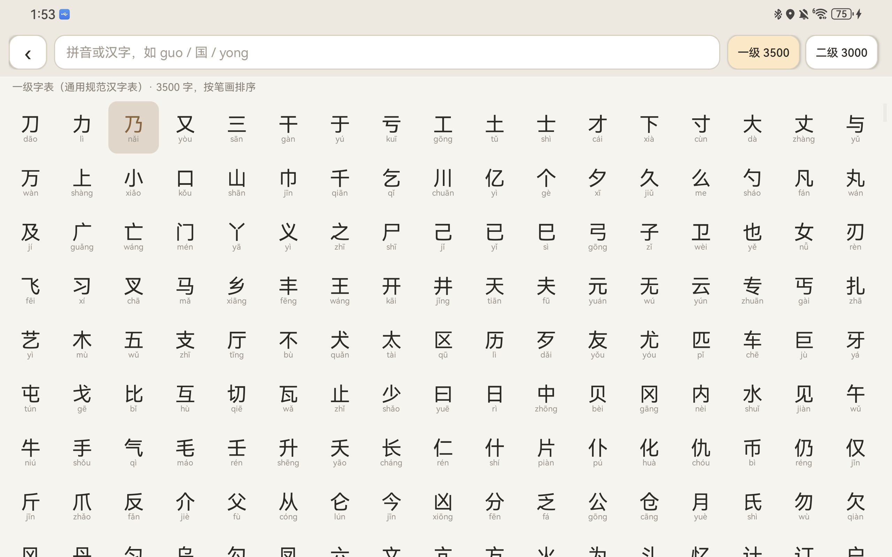
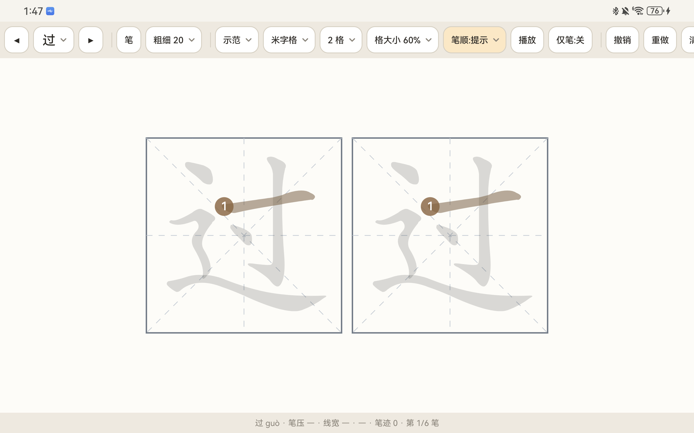
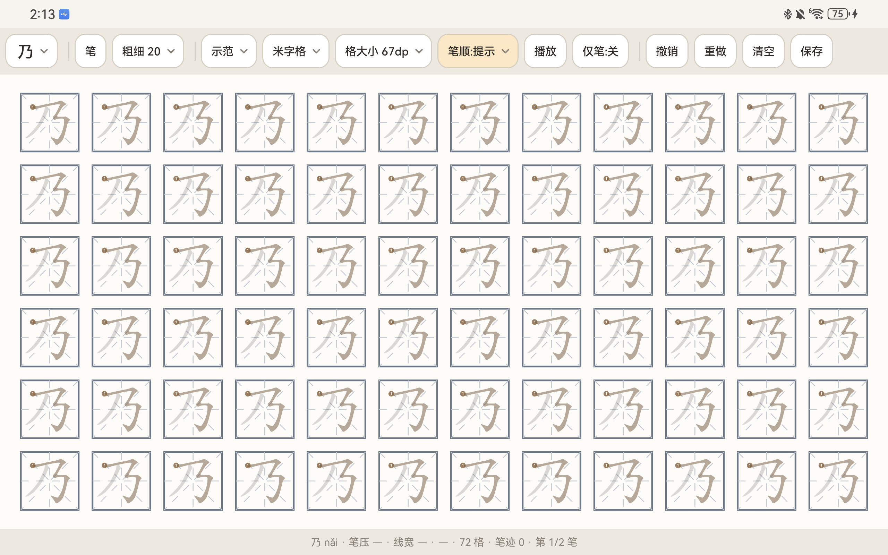

# 墨格练字

<p>
  
  
  
  
</p>

> 仓库名使用拼音 `moge-lianzi`（GitHub 仓库名只支持 ASCII 字符），项目正式名称为「墨格练字」。

面向 **华为 MatePad Pro 11（GOT-W29，HarmonyOS 4.2.0）+ M-Pencil 2** 的练字应用。
Android 原生实现（HarmonyOS 4.x 兼容 APK），针对手写笔的压感与高频采样做了专门优化，
内置《通用规范汉字表》6500 字与逐笔笔顺数据，支持压感书写、笔顺动画和笔顺判定。



---

## 特性

| 模块 | 说明 |
|---|---|
| **字库** | 《通用规范汉字表》一级 3500 字 + 二级 3000 字，按官方笔画顺序排列 |
| **选字** | 独立选字页：一级/二级切换、17 列网格带拼音、支持拼音与汉字搜索（`guo` → 15 条） |
| **压感笔迹** | 线宽 = `penWidth × (0.30 + 0.95 × pressure^0.75)`，再乘速度系数模拟笔锋（快写收细） |
| **低延迟** | `requestUnbufferedDispatch` + 历史点全采样 + 离屏 Bitmap 脏矩形增量绘制 |
| **笔顺提示** | 下一笔用棕色填充真实笔画轮廓，起笔处标序号，写一笔自动推进 |
| **笔顺动画** | 用「沿中线推进的胶囊」裁剪轮廓，逐笔演示，带笔头圆点 |
| **笔顺判定** | 16 点重采样 + 平均距离（含方向反转检测），写错会提示「这笔像第 3 笔，当前应写第 1 笔」 |
| **字帖版面** | 格子大小滑块驱动行列数，自动铺满整页（67dp → 12×6 = 72 格，512dp → 2 格） |
| **格型 / 参照** | 田字格 / 米字格；描红 / 示范 / 隐藏 |
| **工具** | 笔 / 橡皮（`PorterDuff.CLEAR`）、撤销 / 重做 / 清空、保存 PNG 到相册 |
| **手写笔适配** | 手掌防误触（笔书写中忽略手指）、「仅笔」模式、状态栏实时显示笔压/线宽/设备类型 |

## 截图

| 选字页 | 笔顺提示（轮廓对齐） |
|---|---|
|  |  |

| 232dp / 8 格 | 67dp / 72 格 |
|---|---|
|  |  |

## 快速开始

### 环境要求

| 组件 | 版本 | 说明 |
|---|---|---|
| JDK | 17+ | 开发使用 Oracle JDK 21 |
| Android SDK | `platforms;android-33`、`build-tools;34.0.0`、`platform-tools` | `ANDROID_HOME` 指向 SDK 根目录 |
| Gradle | 8.7 | 仓库自带 wrapper，指向腾讯云镜像 |
| AGP | 8.5.2 | 从阿里云 Maven 镜像拉取 |

### 构建

```bash
# Linux / macOS
export ANDROID_HOME=$HOME/Android/Sdk
./gradlew assembleDebug

# Windows
set ANDROID_HOME=C:\Users\<you>\AppData\Local\Android\Sdk
gradlew.bat assembleDebug
```

产物：`app/build/outputs/apk/debug/app-debug.apk`（约 4.6 MB）。
首次构建会从 `settings.gradle` 里配置的国内镜像下载 AGP 依赖。

### 安装到平板

```bash
adb install -r -d app/build/outputs/apk/debug/app-debug.apk
adb shell am start -n com.lz.hanzi/.MainActivity
```

平板端准备（GOT-W29 实测）：

1. 设置 → 关于平板电脑 → 连点「版本号」7 次，进入开发者模式
2. 设置 → 系统和更新 → 开发人员选项 → 打开 **USB 调试**
3. USB 连接电脑后，**下拉通知栏把 USB 模式从「仅充电 / HiSuite」改成「传输文件」**
   —— 不改这一步 Windows 只能看到 `Linux File-CD Gadget` 虚拟光驱，`adb devices` 是空的
4. 如安装被拦截：设置 → 系统和更新 → **纯净模式** → 关闭

仓库里还附了两个 Windows 脚本：`install.ps1`（安装并启动）、`dev.ps1`（构建 + 安装 + 看日志）。

## 使用说明

工具栏从左到右：

| 控件 | 作用 |
|---|---|
| `乃 ⌄` | 打开选字页（分级浏览 / 拼音搜索） |
| `笔` / `橡皮` | 切换工具 |
| `粗细 20 ⌄` | 笔尖粗细，下拉里每档都画了实际粗细的圆点 |
| `示范 ⌄` | 参照字：描红（淡赭）/ 示范（淡灰）/ 隐藏 |
| `米字格 ⌄` | 田字格 / 米字格 |
| `格大小 232dp ⌄` | 滑块调整格子边长，行列数自动推算并铺满整页 |
| `笔顺:提示 ⌄` | 关 / 提示 / 判定 |
| `播放` | 逐笔演示当前字的笔顺 |
| `仅笔:关` | 只接受手写笔输入，彻底防误触 |
| `撤销 / 重做 / 清空 / 保存` | 常规操作，保存写入相册 `Pictures/墨格练字/` |

## 技术要点

- **笔迹渲染**：已落笔的笔画画进与 View 等大的离屏 Bitmap，书写时只增量画到 Bitmap 并
  `invalidate(脏矩形)`，`onDraw` 只做一次 blit，避免整屏重绘。
- **字形与笔顺同源**：参照字不再用字体渲染，而是把 `strokes2.bin` 里的笔画轮廓路径
  （M/L/Q/C/Z + uint8 量化坐标）构建为归一化 `Path`，绘制时统一 `translate + scale`。
  这样高亮、笔头、字形严格对齐，格子缩放时也无需重建。
- **多格性能**：一页最多 96 格时，每帧重画几十份路径会掉帧；改成把一格字形预渲染为
  `ALPHA_8` 位图再贴图（换字/换尺寸才重建），72 格下动画 janky 从 19.8% 降到 3.85%。
- **笔顺判定**：用户笔迹与参考中线都归一化到 0..255（256 = 一格边长），各重采样 16 点后
  算平均距离，正反两向取较小值以识别「写反了」，阈值 24（约一格边长的 9%）。

## 数据与许可

| 数据 | 来源 | 许可 |
|---|---|---|
| 字表与顺序 | 《通用规范汉字表》（2013 年国务院公布）一级 / 二级字表 | — |
| 拼音、笔画数 | [ben-hua/general_standard_chinese](https://github.com/ben-hua/general_standard_chinese) | 见仓库 |
| 笔画轮廓与中线 | [hanzi-writer-data](https://github.com/chanind/hanzi-writer-data)（源自 Make Me a Hanzi） | Arphic Public License，见 [`ARPHICPL.TXT`](ARPHICPL.TXT) |
| 兜底楷体 | 霞鹜文楷（LXGW WenKai）子集，仅含 129 个缺笔顺字 + 常用标点 | SIL OFL 1.1，见 [`OFL-LXGWWenKai.txt`](OFL-LXGWWenKai.txt) |

应用代码以 **MIT** 许可发布，见 [`LICENSE`](LICENSE)。
打包进 APK 的数据与字体仍遵循各自许可，不因本项目的 MIT 许可而改变。

## 目录结构

```
墨格练字/
├── app/src/main/
│   ├── java/com/lz/hanzi/
│   │   ├── MainActivity.java        练字主界面：工具栏、保存、状态栏
│   │   ├── PracticeView.java        画板：压感笔迹、格子布局、笔顺提示/动画/判定
│   │   ├── CharPickerActivity.java  选字页：分级、拼音搜索
│   │   ├── HanziData.java           字库加载（TSV）
│   │   └── StrokeOrder.java         笔顺数据加载（二进制）
│   ├── assets/
│   │   ├── hanzi_l1.tsv / hanzi_l2.tsv   字 / 拼音 / 无声调拼音 / 笔画数
│   │   ├── strokes2.bin                  笔画轮廓 + 中线 + 半宽（6371 字，4.87 MB）
│   │   └── fonts/kai_fallback.ttf        129 字楷体子集（76 KB）
│   └── res/                             图标、主题、箭头
├── docs/screenshots/                     README 用截图
├── install.ps1 / dev.ps1                 Windows 安装 / 调试脚本
└── ARPHICPL.TXT / OFL-LXGWWenKai.txt     第三方许可见
```

## 已知限制

- 二级字表有 129 个生僻字没有笔顺数据（`strokes2.bin` 覆盖 6371/6500），这些字会退回字体渲染，
  没有笔顺提示与动画。
- 笔顺判定只比较中线点位与走向，不判断笔锋、按压力度与结构比例；位置对但写得很潦草的笔画会通过。
- 方形格子铺满矩形页面时，格数只能离散跳变（2 → 8 → 18 → 72），无法连续变化。
- 切格数不会缩放已有笔迹，只有「格大小」滑块会按比例缩放笔迹。

## 更新日志

- **v1.13** 格子尺寸下限 15%（最小 67dp / 72 格），字形位图缓存优化多格动画
- **v1.12** 格子大小驱动行列数并自动铺满；修复格子数组越界导致的闪退
- **v1.11** 每行列数可配、行数自动补满
- **v1.10** 移除左右翻字按钮
- **v1.9** 修复选字页说明文字被裁切
- **v1.8** 参照字改为笔画轮廓渲染，与笔顺严格对齐；APK 12.9 MB → 4.58 MB
- **v1.7** 笔顺提示 / 动画 / 判定
- **v1.6** 格大小滑块联动缩放笔迹
- **v1.5** 格大小滑块
- **v1.4** 参照字 / 格型 / 格数改下拉
- **v1.3** 粗细改下拉
- **v1.2** 6500 字库与搜索选字页
- **v1.1** 网格下拉选字
- **v1.0** 首版：压感书写 + 田字格 + 保存
